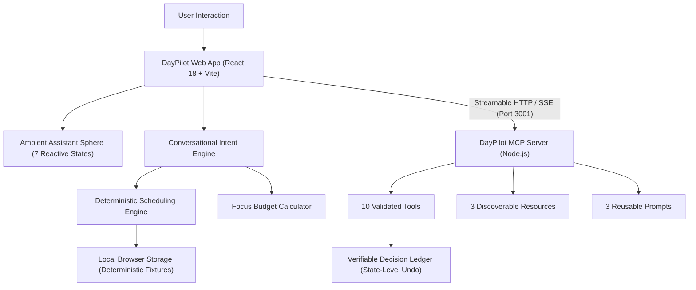

# DayPilot AI — Ambient Agentic Productivity Platform

**Tagline:** Your day, intelligently orchestrated.  
**Developer:** Harsh Saini  
**Primary Track:** Amazon Developer Hackathon — Alexa+  
**License:** MIT License  

---

## 1. Problem & Product Overview

Conventional to-do lists and calendar applications are passive: they store tasks, but when unexpected disruptions occur—a 2-hour morning delay, an urgent client review, or an afternoon energy slump—they leave the user stranded to manually calculate how to recover.

**DayPilot AI** is an independent, Alexa+-inspired ambient personal productivity platform. It continuously maintains a living mathematical model of your day, reasons over hard calendar constraints and mental stamina, stages transparent before-and-after rebalance proposals, executes approved operations via the **Model Context Protocol (MCP)**, and protects user sovereignty with a verifiable **Decision Ledger** and state-level **Undo**.

---

## 2. Four Signature Innovations

### Innovation A — Adaptive Day Flight Director
- **Deterministic Scheduling Engine:** Enforces hard mathematical constraints—fixed calendar commitments are non-negotiable and cannot be moved by automated rebalancing; tasks can never overlap.
- **Dynamic Capacity Management:** Handles disruptions like *"I have only two hours today"* by capping available minutes, scoring tasks by urgency and priority, scheduling the highest-impact subset, and explicitly explaining deferred tasks.
- **Before-and-After Plan Comparisons:** Generates detailed differential audits showing scheduled count, total minutes, deferred count, and individual task slot changes before applying.

### Innovation B — Personal Energy & Focus Budget
- **User-Controlled Pacing:** Three explicit modes: **Low** (25m Pomodoro / 10m rest), **Moderate** (45m / 10m rest), and **High** (60m Flow / 15m consolidation).
- **Cognitive Demand Classification:** Tasks categorized as Low, Moderate, High, or Deep cognitive demand with real-time stamina utilization tracking.
- **Fatigue Protection:** For *"I'm low on energy, but my presentation is due today"*, it decomposes large 90m deliverables into manageable 30m micro-steps with mandatory restorative pauses while protecting critical deadlines.
- **Privacy Disclosure:** All energy levels are user-reported. DayPilot never claims biometric, webcam, or affective emotion detection.

### Innovation C — MCP Integration Studio
- **Official Specification:** Built using `@modelcontextprotocol/sdk` v1.32.1 targeting protocol version `2024-11-05` over **Streamable HTTP & Server-Sent Events (SSE)** on port 3001.
- **10 Validated Tools:**
  1. `get_daily_tasks`
  2. `get_calendar_events`
  3. `create_task`
  4. `propose_schedule_rebalance` *(proposes without mutating state)*
  5. `approve_proposed_action` *(consent gate)*
  6. `reject_proposed_action`
  7. `undo_last_action`
  8. `get_focus_budget`
  9. `summarize_day`
  10. `get_decision_history`
- **3 Discoverable Resources:** `daypilot://tasks/today`, `daypilot://schedule/today`, `daypilot://budget/focus`
- **3 Reusable Prompts:** `daily_planning`, `deadline_recovery`, `low_energy_planning`
- **Interactive Tool Inspector:** Test and inspect tool schemas, arguments, execution duration, and results live in the browser.

### Innovation D — Trust, Consent & Decision Ledger
- **Verifiable Audit Log:** Chronological record of user requests, proposed operations, constraints, expected benefits, and trade-offs.
- **Explicit Consent Lifecycle:** `proposed → approved → applied` (or `rejected`, `undone`). Consequential actions require explicit user confirmation.
- **Working State-Level Undo:** Restores the exact prior state snapshot rather than merely posting a cosmetic message.

---

## 3. Seven Destination Experiences

1. **Command Center:** Ambient assistant sphere, today's completion progress, next recommended task, upcoming deadlines, available focus budget, schedule status, and quick natural-language commands.
2. **Daily Flight Plan:** Interactive day timeline (09:00 - 17:00), task list with status filters, add task modal, fixed calendar commitments, conflict warnings, deferred task panel, and before/after comparison modal.
3. **Conversational Assistant:** Ambient chat with keyboard navigation, context-grounded responses, tool execution indicators, structured action proposal cards, and inline confirmation gates.
4. **Focus Studio:** Energy selector, focus session duration settings, cognitive demand workload breakdown, pacing advice, and low-energy testing scenarios.
5. **MCP Integration Studio:** Server connection status, protocol metadata, discoverable tools catalog, interactive tool tester, resource inspector, prompt library, and session execution history.
6. **Decision Ledger:** Chronological activity history, request details, approval status, reasoning, trade-offs, and working Undo buttons.
7. **Settings & Privacy:** Reduced-motion toggle, optional synthesized audio feedback (OFF by default), MCP server URL configuration with connection ping, and one-click Demo Reset.

---

## 4. Technical Architecture



---

## 5. Prerequisites & Getting Started

### Prerequisites
- **Node.js:** v18.0.0 or later (tested on Node.js v22.14.0)
- **npm:** v9.0.0 or later (tested on npm 10.9.2)

### Installation
Clone or navigate to the repository directory and install all workspace dependencies:

```bash
npm install
```

### Running the Application

#### Option 1: Run Web Application (with Local Deterministic Runtime)
```bash
npm run dev
```
Open [http://localhost:5173](http://localhost:5173) in your browser.

#### Option 2: Run MCP Backend Server
In a separate terminal:
```bash
npm run server
```
The Model Context Protocol server starts on [http://localhost:3001](http://localhost:3001).  
Health check: [http://localhost:3001/health](http://localhost:3001/health)  
MCP Manifest: [http://localhost:3001/api/mcp/manifest](http://localhost:3001/api/mcp/manifest)

#### Option 3: Run Full Workspace Build & Tests
```bash
npm test        # Runs Vitest automated test suite (16 tests)
npm run build   # Builds shared package, MCP server, and web production bundle
```

---

## 6. Verified Features vs. Disclosed Limitations

| Feature | Status | Notes |
|---|---|---|
| **Deterministic Planning Engine** | **Verified & Tested** | Mathematically enforces non-overlapping slots and preserves fixed events |
| **Natural Language Understanding** | **Verified & Tested** | Supports 12+ conversational command patterns offline without API fees |
| **Personal Focus Budget** | **Verified & Tested** | Cognitive demand breakdown, session pacing, and low-energy adaptation |
| **Real MCP Server (v2024-11-05)** | **Verified & Tested** | Streamable HTTP/SSE transport, 10 tools, 3 resources, 3 prompts |
| **Consent Gate & Action Proposals** | **Verified & Tested** | Consequential actions require approval before mutating state |
| **State-Level Undo** | **Verified & Tested** | Restores exact pre-execution state snapshot from ledger |
| **Ambient Assistant Sphere** | **Verified & Tested** | 7 animated visual states with `prefers-reduced-motion` compliance |
| **GitHub Pages Deployment** | **Configured** | CI/CD workflow ready (`.github/workflows/deploy.yml`) with relative base paths |
| **External Google/Outlook Sync** | *Disclosed Limitation* | Uses deterministic fixed event fixtures; third-party OAuth not simulated |
| **Biometric / Health Detection** | *Disclosed Limitation* | Energy is strictly user-reported; no biometric claims |

---

## 7. 3-Minute Demo Flow

1. **0:00 - 0:20 | Introduction:** Inspect Command Center, today's 8 tasks, 2 fixed meetings, and balanced focus budget.
2. **0:20 - 0:55 | Adaptive Planning:** Ask *"I have only two hours today."* Inspect the proposal, observe how critical presentations are protected while low-priority tasks are deferred, and click **Approve & Execute**.
3. **0:55 - 1:25 | Energy Pacing:** Ask *"I'm low on energy, but my presentation is due today."* Observe task decomposition into 30m blocks with 10m restorative breaks.
4. **1:25 - 2:00 | Real MCP Studio:** Open **MCP Integration Studio**, verify the live server connection, inspect discoverable tools, and invoke `get_daily_tasks` live.
5. **2:00 - 2:35 | Consent & Undo:** Propose moving lowest-priority task to tomorrow, approve it, navigate to **Decision Ledger**, and click **Undo This Action** to restore state.
6. **2:35 - 3:00 | Finish:** Click **Reset Demo** in the top navigation bar to restore factory baseline.

---

## 8. License & Attribution

This project is released under the **MIT License**.  
Developed by **Harsh Saini** for the **Amazon Developer Hackathon — Alexa+ Track**.  
*Disclaimer: DayPilot AI is an independent prototype and is not an official Amazon product.*
