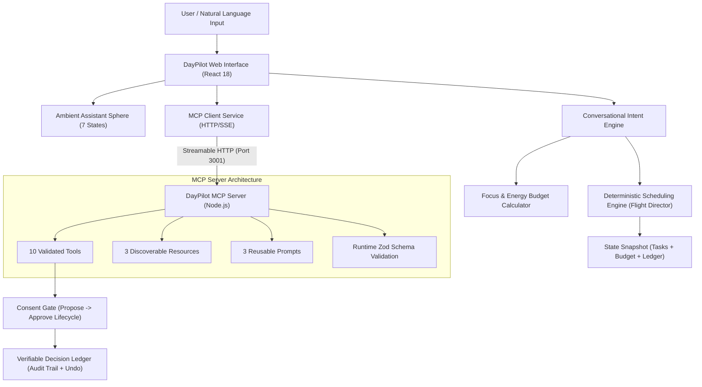

# DayPilot AI — Technical Architecture & Protocol Specification

## 1. System Overview

DayPilot AI is architected as an ambient, agentic productivity platform structured in a modular TypeScript monorepo:

```text
Amazon/
├── apps/
│   ├── web/                    # React 18 + Vite + Tailwind CSS + Lucide Icons
│   └── mcp-server/             # Node.js + @modelcontextprotocol/sdk + Express (Port 3001)
├── packages/
│   └── shared/                 # Core scheduling engine, types, budget calculator, intent parser
├── tests/                      # Automated Vitest test suite
├── submission/                 # Demo scripts, Devpost documentation, architecture diagrams
└── .github/workflows/          # GitHub Pages CI/CD workflow
```

---

## 2. Architecture Diagram



---

## 3. Scheduling Invariants & Mathematics

The deterministic scheduling engine (`packages/shared/src/scheduler.ts`) enforces strict mathematical invariants:

1. **Fixed Commitment Inviolability:**
   $$\forall e \in \text{FixedEvents}, \forall t \in \text{ScheduledTasks}: [t_{\text{start}}, t_{\text{end}}] \cap [e_{\text{start}}, e_{\text{end}}] = \emptyset$$
2. **Mutual Slot Exclusion (No Overlaps):**
   $$\forall t_i, t_j \in \text{ScheduledTasks} \ (i \neq j): t_i.\text{end} \le t_j.\text{start} \lor t_j.\text{end} \le t_i.\text{start}$$
3. **Window Extraction:** Available windows between fixed commitments are derived deterministically:
   $$\text{Windows} = \text{MergeSort}(\text{Workday} \setminus \bigcup e_k)$$
4. **Multi-Factor Task Scoring Function:**
   $$\text{Score}(t) = W_{\text{priority}}(t.\text{priority}) + W_{\text{urgency}}(t.\text{deadline}) + W_{\text{energy}}(t.\text{cognitiveDemand}, \text{Energy})$$

---

## 4. Model Context Protocol (MCP) Specification Details

- **Protocol Version:** `2024-11-05`
- **Transport:** Streamable HTTP & Server-Sent Events (SSE)
- **SDK:** `@modelcontextprotocol/sdk` v1.32.1

### Available Tools (10)
| Tool Name | Parameters | Purpose | State Mutation |
|---|---|---|---|
| `get_daily_tasks` | `status?: string` | Retrieve daily task list | Read-only |
| `get_calendar_events` | None | Retrieve fixed meetings | Read-only |
| `create_task` | `title, duration, priority, deadline, category, cognitiveDemand` | Add a validated task | Direct Write |
| `propose_schedule_rebalance` | `maxCapacityMinutes?, energyLevel?, preferredBreakMinutes?` | Calculate proposed schedule | **Proposal Only** |
| `approve_proposed_action` | `actionId` | Apply a proposed rebalance | **Consequential Write** |
| `reject_proposed_action` | `actionId, reason?` | Reject proposed rebalance | Status only |
| `undo_last_action` | None | Revert last applied state change | **State Restoration** |
| `get_focus_budget` | None | Query cognitive stamina metrics | Read-only |
| `summarize_day` | None | High-level day summary | Read-only |
| `get_decision_history` | `limit?: number` | Verifiable audit log query | Read-only |

### Discoverable Resources (3)
1. `daypilot://tasks/today` — JSON collection of today's tasks
2. `daypilot://schedule/today` — Current chronological timeline slots
3. `daypilot://budget/focus` — Real-time focus utilization and cognitive workload breakdown

### Reusable Prompts (3)
1. `daily_planning` — Multi-constraint whole-day orchestration prompt
2. `deadline_recovery` — Emergency recovery prompt for disrupted time
3. `low_energy_planning` — Energy-sparing Pomodoro pacing template

---

## 5. Security & Privacy Disclosure
- **No Private Keys Committed:** The architecture requires zero paid API keys or cloud credentials.
- **Client-Side Data Sovereignty:** Demo state is stored safely in browser `localStorage`.
- **Zero Hallucination Schedulers:** Schedulers are pure deterministic functions, ensuring zero false schedules.
- **Untrusted Output Handling:** External payloads and MCP outputs are validated against strict Zod schemas before application.
